# HoneyChic

A self-hosted shop for independent sellers and small stores. **AdonisJS 7, Vue 3 + Inertia SSR, PostgreSQL.** English and Vietnamese throughout.

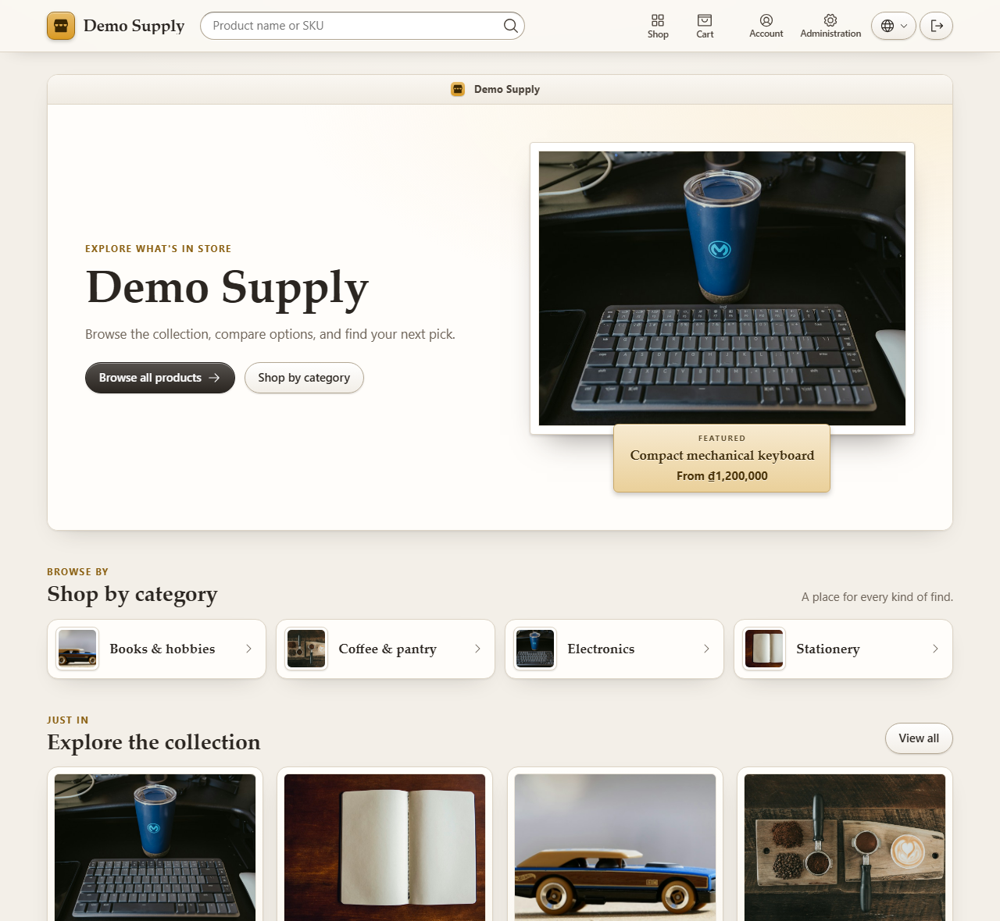

## What you get

- Products with options and variants, recorded stock, search and category filters.
- Session cart, guest and account checkout, order history that survives catalog changes.
- Admin: orders, refunds and returns, customers, inventory, CSV product import/export, order CSV.
- Optional features you switch on: reviews, wishlist, coupons, shipping rates, cash on delivery.
- Unpaid orders can expire after a lifetime you choose; their stock comes back.
- Your brand: name, logo, favicon, colors, contact details and social links.

## Run it locally

Inside WSL (Linux Node 24, npm 11+, Docker):

```bash
cp .env.example .env
docker compose up -d --wait
npm install
node ace generate:key
node ace migration:run
node ace db:seed        # optional demo catalog (development only)
npm run dev
```

Open <http://localhost:3333/welcome> to create the owner account. In development the setup code is shown on the page; in production it is in the server log, or run `node ace owner:code`. Then finish the shop basics at `/admin/setup`.

[Storefront](http://localhost:3333) · [Admin](http://localhost:3333/admin) · [Mailpit](http://localhost:8025)

## Deploy it

One container plus PostgreSQL. `compose.production.yaml` runs migrations on start, keeps uploads on a volume and expires unpaid orders in-process. Hosting, SMTP and storage are your choice. See [Operations](docs/OPERATIONS.md).

## Screens

| Catalog                                                                           | Product                                                                                    |
| --------------------------------------------------------------------------------- | ------------------------------------------------------------------------------------------ |
| 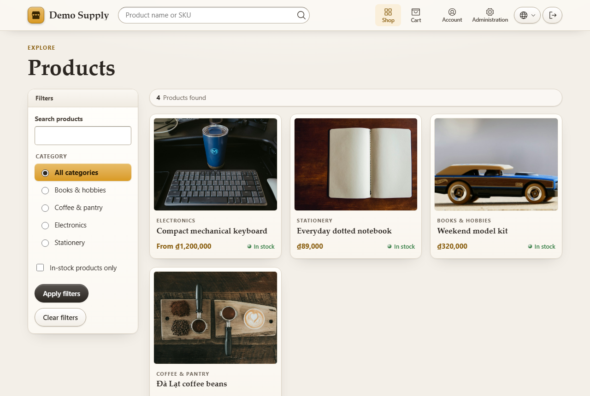           | 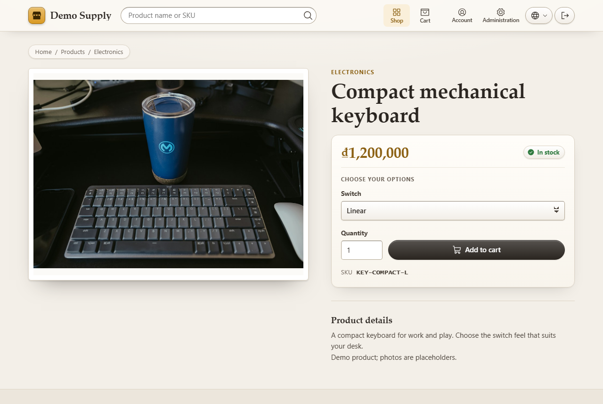              |
| **Cart**                                                                          | **Checkout**                                                                               |
| 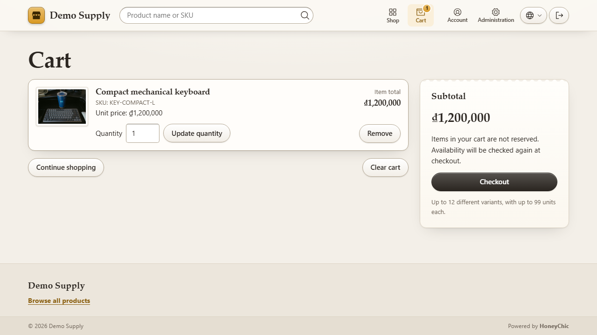                     | 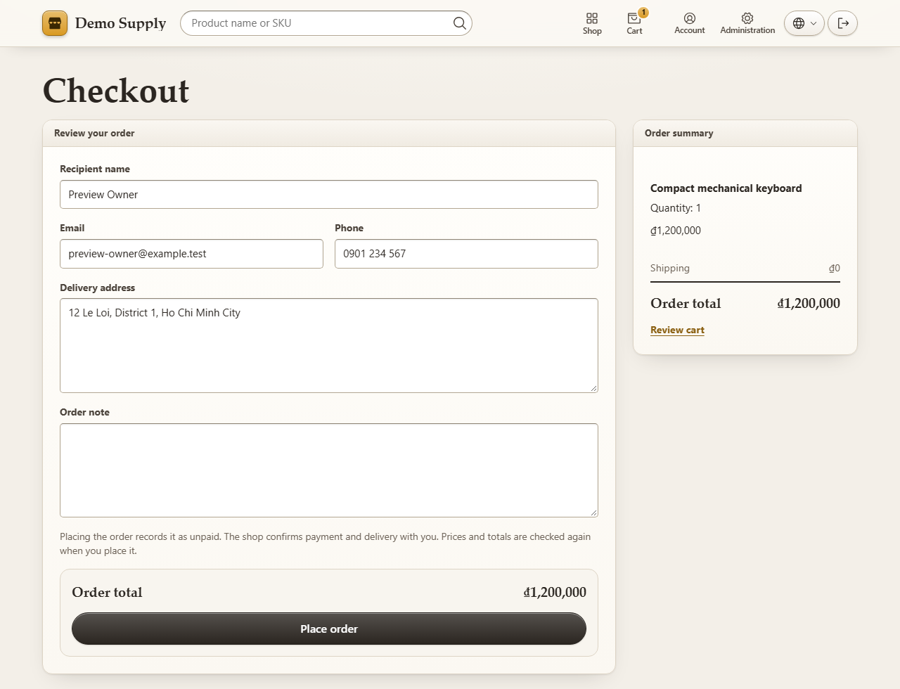                          |
| **Admin overview**                                                                | **Order detail**                                                                           |
| 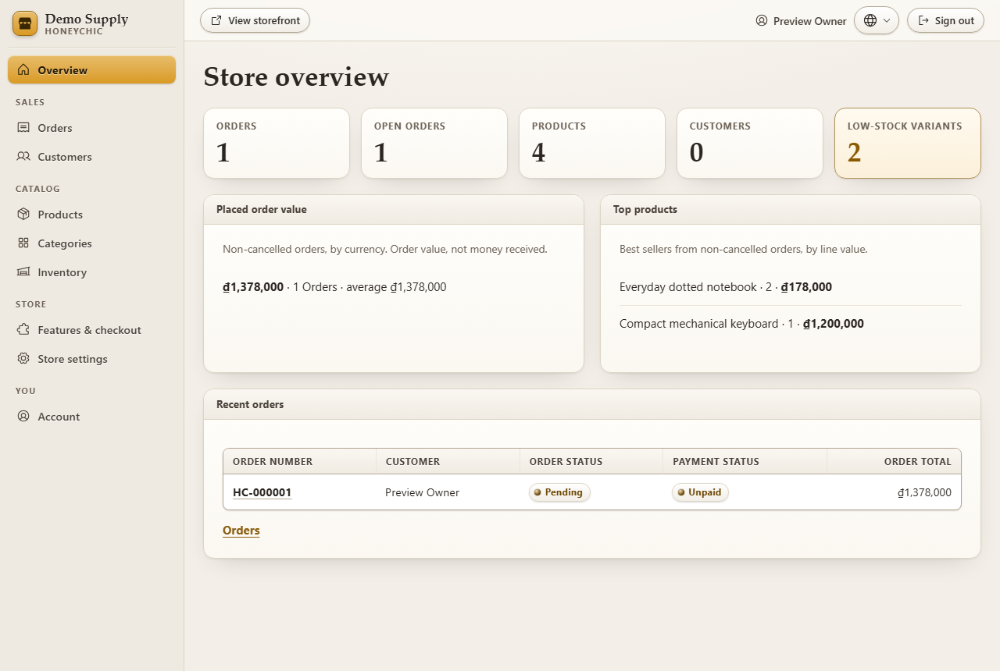 | 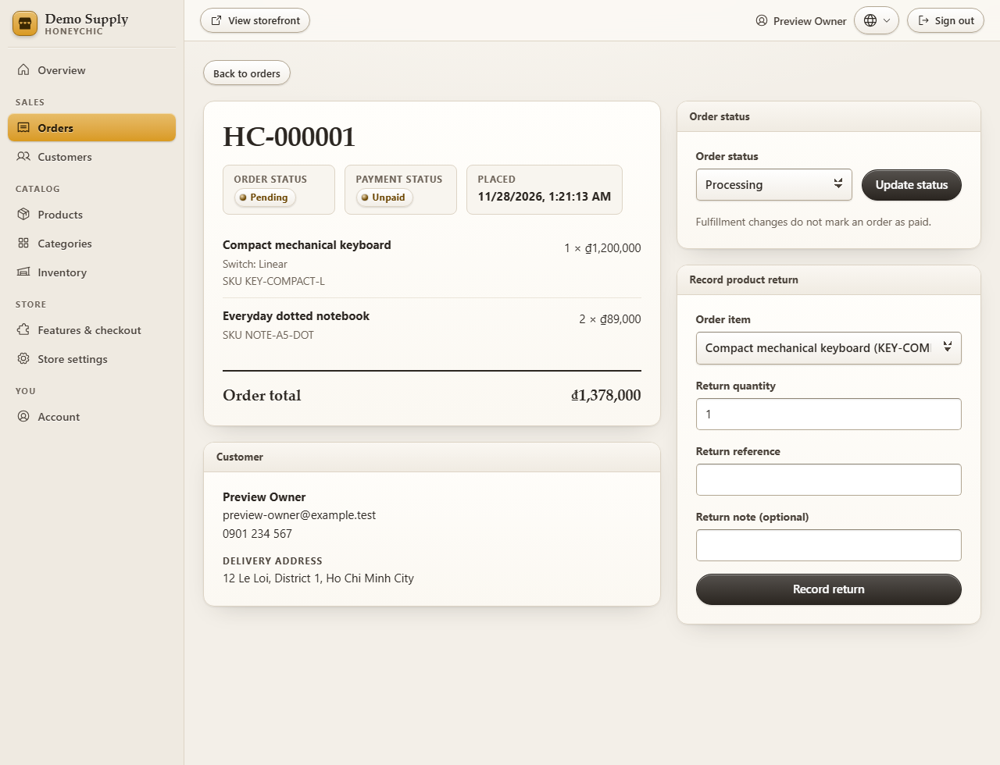 |
| **Features & checkout**                                                           | **Products with CSV import/export**                                                        |
| 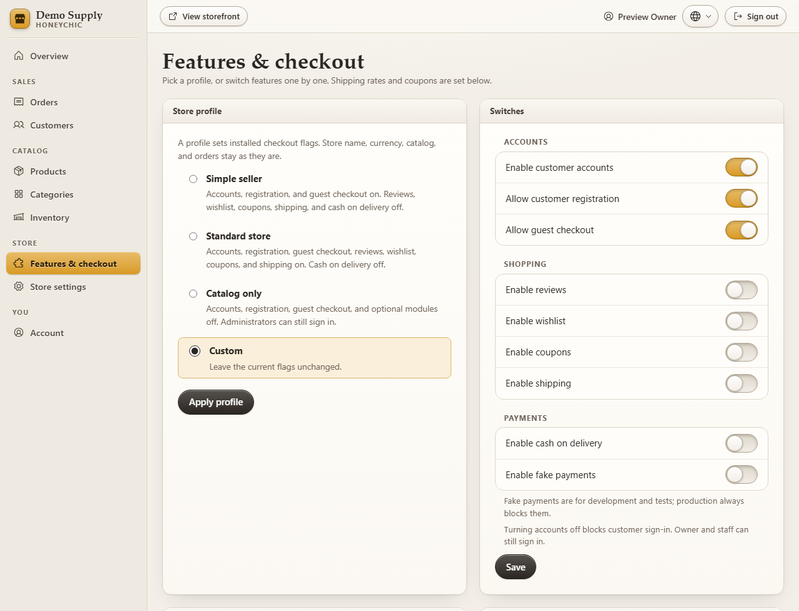     | 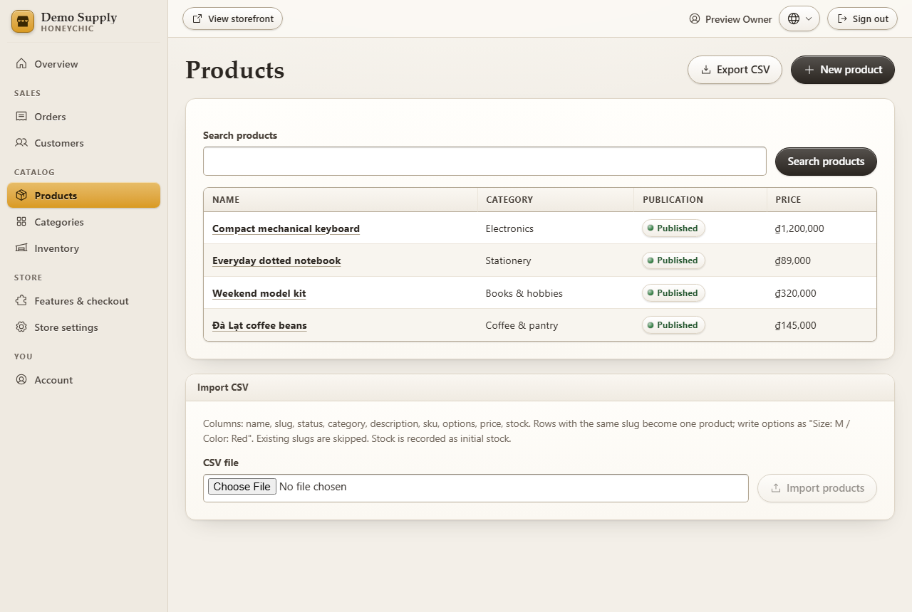      |

<p>
  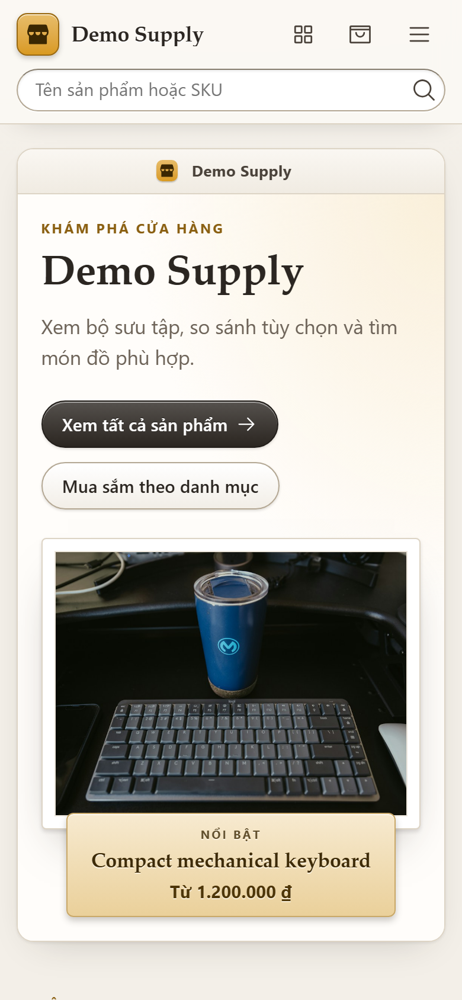
  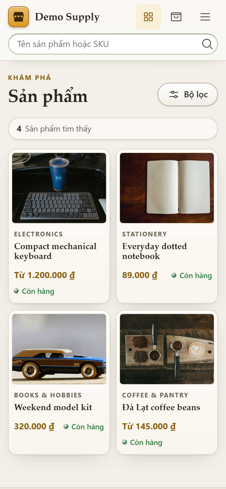
</p>

Screenshots are Microsoft Edge captures of the demo catalog.

## Docs

| Guide                                    | For                                                                                |
| ---------------------------------------- | ---------------------------------------------------------------------------------- |
| [Architecture](docs/ARCHITECTURE.md)     | Where code lives, optional features, how to add your own payment, storage or theme |
| [Commerce rules](docs/COMMERCE_RULES.md) | Money, stock, orders and checkout invariants                                       |
| [Operations](docs/OPERATIONS.md)         | Development, tests, deployment, backups, security                                  |
| [UI](docs/UI.md)                         | Visual language and interaction rules                                              |
| [Roadmap](docs/ROADMAP.md)               | What is done, next and later                                                       |

Demo photos: [sources and license](docs/MEDIA.md). Laravel v1 lives at the `larastore-v1-final` tag. License: MIT.
